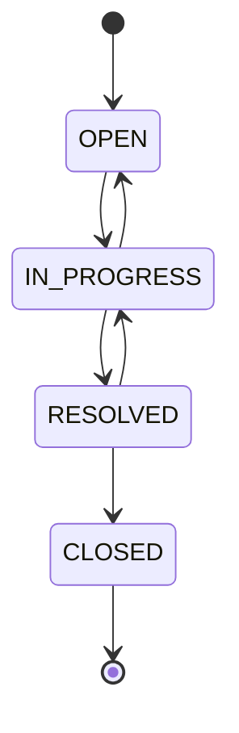

# SupportFlowApp

REST API сервиса заявок в поддержку: сотрудники создают тикеты, агенты берут их в работу, переписываются в комментариях и закрывают. Жизненный цикл тикета контролируется правилами переходов статусов.
Проект вырос из консольного приложения на Java Core: доменная модель и бизнес-правила сохранились, интерфейс заменён на REST API с базой данных PostgreSQL.

## Стек

| Область | Технологии |
|---|---|
| Язык | Java 21 |
| Фреймворк | Spring Boot, Spring Web, Spring Data JPA (Hibernate), Bean Validation |
| База данных | PostgreSQL, миграции Liquibase |
| Документация API | Swagger UI (springdoc-openapi) |
| Инфраструктура | Docker, Docker Compose |
| Сборка | Maven (Maven Wrapper), Lombok |


### Возможности
    • Создание тикетов, получение по id, поиск с фильтрами (status, priority, assigneeId), пагинацией и сортировкой
    • Назначение исполнителя
    • Смена статуса с проверкой допустимых переходов
    • Комментарии к тикетам
    • Единый формат ошибок с подробностями валидации
  
### Быстрый старт
Нужны: JDK 21 и Docker.

```bash
# 1. Клонировать репозиторий
git clone https://github.com/samsa8590/SupportFlowApp.git
cd supportFlowApp

# 2. Поднять PostgreSQL
docker compose up -d

# 3. Запустить приложение
./mvnw spring-boot:run
```
Приложение стартует на `http://localhost:8080`. Миграции Liquibase применяются автоматически при запуске и создают таблицы вместе с тремя демо-сотрудниками.

- Swagger UI: http://localhost:8080/swagger-ui/index.html
- OpenAPI-описание: http://localhost:8080/v3/api-docs

Параметры подключения к БД заданы в `application.yaml` и переопределяются переменными окружения `DB_USERNAME` и `DB_PASSWORD`.

Остановить базу: `docker compose down`.

Параметры подключения к БД заданы в application.yaml и переопределяются переменными окружения DB_USERNAME и DB_PASSWORD.

## Демо-данные

Миграция `004-seed-employees` создаёт трёх сотрудников для ручной проверки:

| id  | Имя           | Роль     |
| --- | ------------- | -------- |
| 1   | Anna Employee | EMPLOYEE |
| 2   | Boris Agent   | AGENT    |
| 3   | Clara Admin   | ADMIN    |


Аутентификации пока нет: автор тикета и комментария передаётся в теле запроса (`authorId`).

## API

| Метод | Путь | Описание |
|---|---|---|
| POST | `/api/tickets` | Создать тикет |
| GET | `/api/tickets` | Список с фильтрами и пагинацией |
| GET | `/api/tickets/{id}` | Получить тикет |
| PATCH | `/api/tickets/{id}/status` | Сменить статус |
| PATCH | `/api/tickets/{id}/assignee` | Назначить исполнителя |
| POST | `/api/tickets/{ticketId}/comments` | Добавить комментарий |
| GET | `/api/tickets/{ticketId}/comments` | Комментарии тикета |


### Пример сценария

```bash
# Создать тикет от сотрудника 1
curl -X POST localhost:8080/api/tickets -H 'Content-Type: application/json' \
  -d '{"title":"Не работает VPN","description":"Не подключается с утра","authorId":1}'

# Назначить агента 2
curl -X PATCH localhost:8080/api/tickets/1/assignee -H 'Content-Type: application/json' \
  -d '{"assigneeId":2}'

# Перевести в работу
curl -X PATCH localhost:8080/api/tickets/1/status -H 'Content-Type: application/json' \
  -d '{"status":"IN_PROGRESS"}'

# Оставить комментарий
curl -X POST localhost:8080/api/tickets/1/comments -H 'Content-Type: application/json' \
  -d '{"authorId":2,"text":"Принял в работу"}'

# Найти тикеты в работе, 10 на страницу, сначала с высоким приоритетом
curl 'localhost:8080/api/tickets?status=IN_PROGRESS&size=10&sort=priority,desc'
```

### Формат ошибок

```json
{
  "timestamp": "2026-11-07T08:30:00Z",
  "status": 409,
  "error": "Conflict",
  "message": "Transition from OPEN to CLOSED is not allowed. Allowed: [IN_PROGRESS]",
  "path": "/api/tickets/1/status"
}
```

Ошибки валидации (HTTP 400) дополнительно содержат `fieldErrors` с сообщением по каждому полю.

## Бизнес-правила

Допустимые переходы статусов:



- В `IN_PROGRESS` тикет можно перевести только после назначения исполнителя.
- Исполнителем может быть только активный сотрудник с ролью `AGENT` или `ADMIN`.
- Закрытому тикету нельзя назначить исполнителя и нельзя добавить комментарий.
- Создавать тикеты могут только активные сотрудники.
  
## Структура проекта

```
src/main/java/io/github/samsa8590/supportflow/
├── config/        конфигурация (OpenAPI)
├── controller/    REST-контроллеры
├── dto/           request / response объекты
├── entity/        JPA-сущности
├── enums/         TicketStatus, Priority, Role
├── exception/     исключения и глобальный обработчик ошибок
├── mapper/        преобразование entity <-> DTO
├── repository/    Spring Data репозитории
└── service/       бизнес-логика
src/main/resources/
└── db/changelog/  миграции Liquibase
```

## Технические решения
    - DTO отдельно от сущностей. Внутренняя модель не утекает в API, формат ответа можно менять независимо от схемы БД.
    - Правила статусов живут в enum TicketStatus.
    - Liquibase вместо ddl-auto. Схема версионируется, а Hibernate только проверяет её соответствие объектам.
    - Фильтрация через Specification.

## Планы развития

- Юнит-тесты (JUnit 5, Mockito) и интеграционные тесты на Testcontainers
- Аутентификация и авторизация (Spring Security, JWT), разграничение прав по ролям
- История изменений тикета (аудит)
- Dockerfile для приложения и CI на GitHub Actions
- Статистика по тикетам
